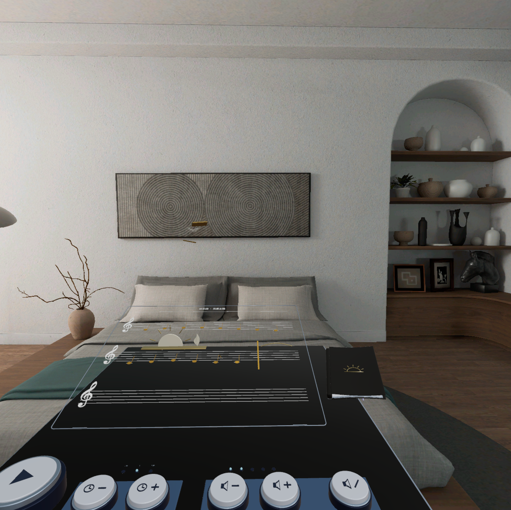
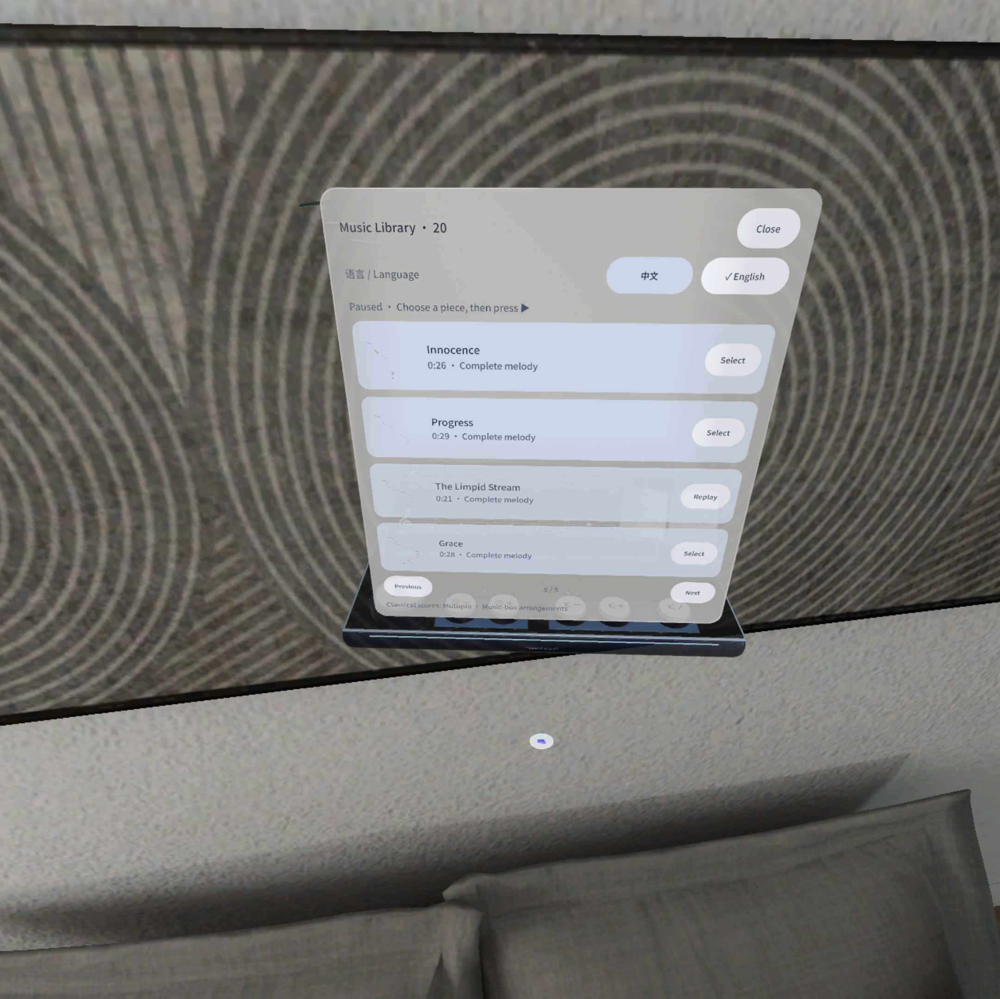
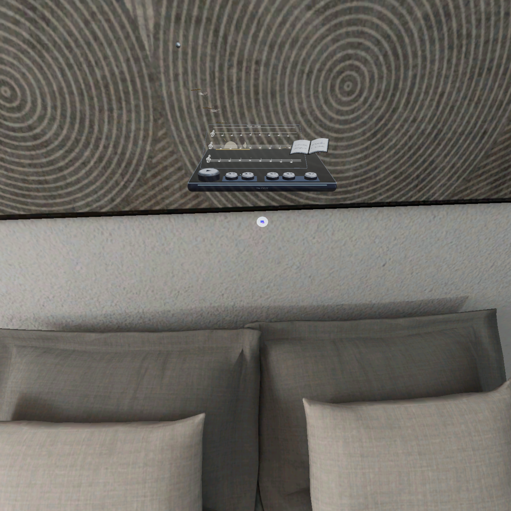

# Marble Melody Space | 钢球音乐盒

[中文说明](README.zh-CN.md) · [Download release APK](https://github.com/kejing-dev/marble-melody-space/releases/latest)

A spatial music box for PICO shared space: a steel marble bounces across sculpted note plates and plays complete melodies.



| Score library (中文) | Score library (English) |
| --- | --- |
|  |  |



## Play

- A polished steel ball rolls, drops and rebounds across a course of note plates; every contact plays the next note of the melody, timed from the original score.
- Twenty complete single-line arrangements — Ode to Joy, Canon in D, the three Gymnopédies, Schumann's Kinderszenen pieces, Burgmüller studies and more — each with its own route and themed materials.
- Open the score book to browse the library (four songs per page) and switch between Chinese and English. The language choice is remembered.
- A physical control deck on the music box: a large play/pause key, speed −/+, volume −/+ and mute.
- The course scrolls with the ball so the previous, current and upcoming note plates stay in view.

## Build

Use JDK 21, Android SDK platform 35 and the checked-in Gradle wrapper. The project uses PICO Spatial SDK / SpatialUI **6.1.9**, Kotlin and Noto Sans SC. Do not upgrade the SDK implicitly.

```sh
./gradlew testDebugUnitTest assembleDebug
./gradlew assembleRelease
```

On Windows use `gradlew.bat`. Set `ANDROID_HOME` or create an untracked `local.properties` containing `sdk.dir`. Dependencies are fetched from Google, Maven Central and the PICO artifact repository declared in `settings.gradle.kts`.

The release build is a non-debuggable, **unsigned** APK (`app-release-unsigned.apk`). The project deliberately configures no release keystore: the distribution platform re-signs the package in its own pipeline. Sign it yourself with `apksigner` only for local sideloading. Its certificate will differ from earlier development APKs, so Android cannot overwrite a debug-signed install; back up any needed data before replacing it.

## Project layout

`app/src/main` contains the Kotlin app and this game's runtime assets (score-box and 20 route GLB models, note samples, album art). `models` contains the editable Blender sources. The deterministic simulation library and regression suite are shared with the original four-game prototype, so unused game branches remain in source; this project builds only Marble Melody Space and bundles no other game's media. Test fixtures live in `app/src/test/fixtures`; tests write their reports to `build/reports/simulation`.

## Verification and limits

See [validation](docs/VALIDATION.md) for build, test and APK evidence. Screenshots are native PICO emulator captures from development builds (v0.27 playing view, v0.26 library and overview); they are not mockups and do not prove physical hand input. Real hand tracking, subjective sound, binocular comfort and sustained device performance still require device testing.

## Music, assets and third-party licenses

Melodies are single-line music-box reductions; sources, licenses and changes for all 20 pieces are listed in [music-scores.md](licenses/music-scores.md), and the original Mutopia MIDI files are in `licenses/midi`. Several pieces are Creative Commons Attribution works from the Mutopia Project and keep their attribution there. Game models are original GLB/Blender files. Noto Sans SC is covered by the [SIL Open Font License](licenses/NotoSansSC-OFL.txt). PICO Spatial SDK and Android dependencies retain their respective licenses. No signing keys, device identifiers or private conversation transcripts are included.
