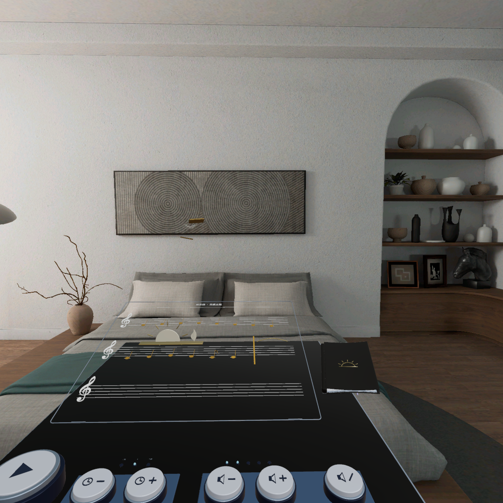
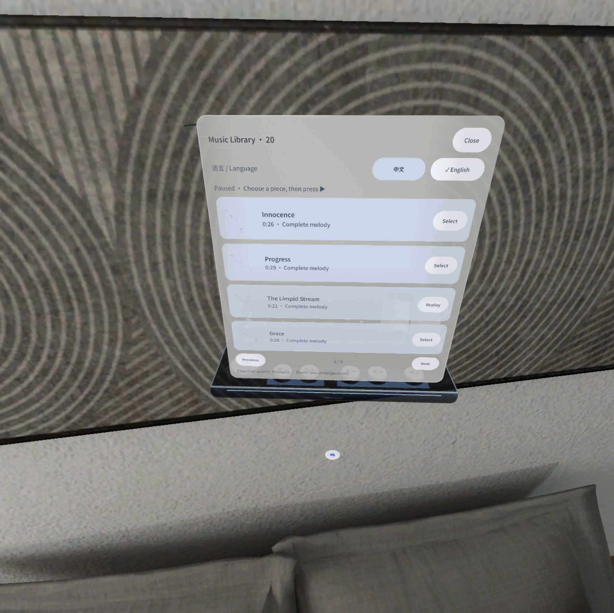
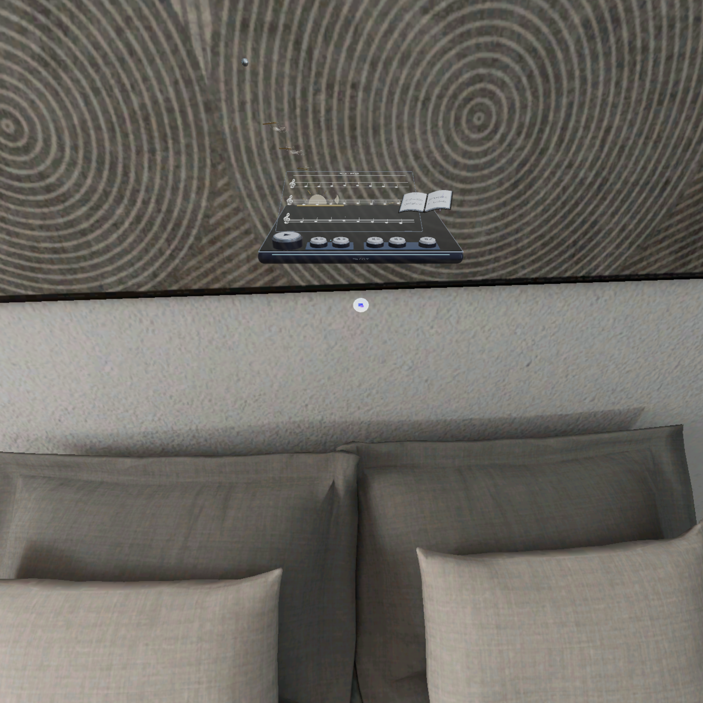

# Marble Melody Space | 钢球音乐盒

[English](README.md) · [下载 release APK](https://github.com/kejing-dev/marble-melody-space/releases/latest)

适用于 PICO shared space 的空间音乐盒：钢球在雕刻的音符板间弹跳，奏出完整旋律。



| 曲库（中文） | 曲库（English） |
| --- | --- |
|  |  |



## 玩法

- 钢球在音符板组成的轨道上滚动、下落、回弹，每次碰撞按原谱时值奏出旋律的下一个音。
- 二十首完整单旋律编曲：欢乐颂、D 大调卡农、三首吉姆诺佩蒂、舒曼《童年情景》选段、布格缪勒练习曲等，每首都有独立轨道与主题材质。
- 打开曲谱书浏览曲库（每页四首），可在中文与 English 间切换，语言选择会被记住。
- 音乐盒上的实体控制台：大号播放 / 暂停键、速度 −/+、音量 −/+ 与静音。
- 轨道随钢球滚动展示，上一个、当前与接下来的音符板始终在视野内。

## 构建

使用 JDK 21、Android SDK platform 35 和仓库中的 Gradle wrapper。项目保持 PICO Spatial SDK / SpatialUI **6.1.9**，使用 Kotlin 与 Noto Sans SC。

```sh
./gradlew testDebugUnitTest assembleDebug
./gradlew assembleRelease
```

Windows 下使用 `gradlew.bat`。通过 `ANDROID_HOME` 或未跟踪的 `local.properties` 配置 Android SDK。

release 构建产物为关闭调试标记的**未签名** APK（`app-release-unsigned.apk`）。工程中不配置 release keystore，由分发平台流水线统一重签名；仅本地侧载时可自行用 `apksigner` 签名。签名与此前开发版不同，不能直接覆盖旧 debug 安装；替换前请自行备份需要的数据。

## 源码与验证

`app/src/main` 为 Kotlin 应用及本游戏的运行资源（曲谱盒与 20 条轨道 GLB、音符采样、专辑封面），`models` 为 Blender 源模型。模拟库及回归测试延续四应用原型的共享实现，因此源码保留未启用的游戏分支；本仓库只构建钢球音乐盒，不打包其他游戏的媒体。测试输入在 `app/src/test/fixtures`，测试报告写入 `build/reports/simulation`。

构建、测试与 APK 校验见 [验证记录](docs/VALIDATION.md)。截图来自开发版模拟器原生运行画面（v0.27 演奏视角，v0.26 曲库与全景），不代表真实手势验收。真实手部追踪、主观音效、双目舒适度和长时性能仍需设备测试。

## 曲目与资源许可

旋律为单声部音乐盒改编；20 首曲目的来源、许可与改动见 [music-scores.md](licenses/music-scores.md)，Mutopia 原始 MIDI 在 `licenses/midi`。部分曲目为 Mutopia Project 的 CC BY 作品，署名保留在该文件中。游戏模型为原创 GLB / Blender 文件；Noto Sans SC 遵循 [SIL OFL](licenses/NotoSansSC-OFL.txt)。PICO SDK 与 Android 依赖分别遵循其许可。签名密钥、设备标识和完整开发对话不放入应用仓库。
